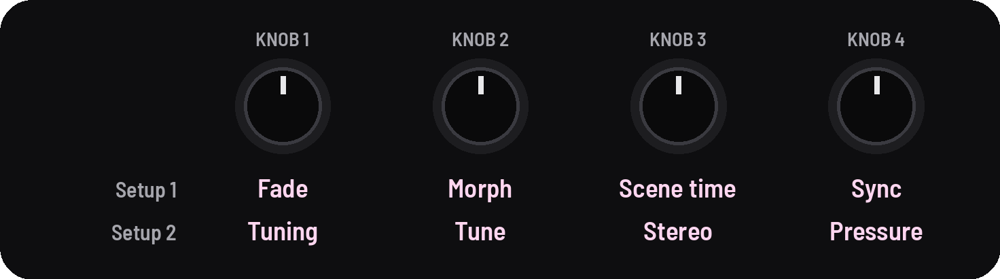
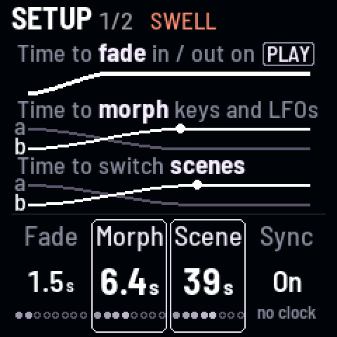
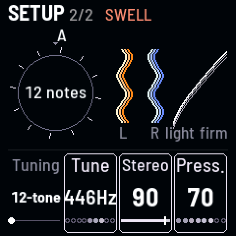

<!-- SPDX-License-Identifier: GPL-3.0-only -->

## Setup

Settings for the FM-1 itself, not for a sound: how long changes take, the clock, the Tuning and the keys' touch.

## Knobs

[[GLO]] opens Setup 1; [[GLO]] again, Setup 2. These belong to the FM-1, not to a sound: scenes don't change them,
except the Tuning.

## Setup 1

| KNOB 1 | KNOB 2 | KNOB 3 | KNOB 4 |
|---|---|---|---|
| fade | morph | scene time | sync |

| Knob | What it does |
|---|---|
| **Fade** | how long PLAY takes: up to 60 s (1.5 s to start) |
| **Morph** | how long a black key or a new LFO wave takes to move the sound: 0.02–30 s (2 s to start) |
| **Scene time** | how long every scene move takes: 0.1 s to 5 minutes (about 8 s to start) |
| **Sync** | **On** follows a MIDI clock; **Off** ignores it |

## Setup 2

| KNOB 1 | KNOB 2 | KNOB 3 | KNOB 4 |
|---|---|---|---|
| tuning | tune | stereo | pressure |

| Knob | What it does |
|---|---|
| **Tuning** | the notes the pitch knobs move through ([Tunings](#tunings)) |
| **Tune** | A's pitch: 427 to 453 Hz (440 to start) |
| **Stereo** | mono to drone I left, drone II right |
| **Pressure** | how hard you press the scene keys: up for a light touch, down for a firm one |

## Tunings

> **A sound carries its Tuning.** A scene saved on LMY brings LMY back, even with Pitch lock on. A Preset plays on
> 12-tone unless it has its own. The Tuning changes half way through a scene's glide.

| Tuning | What it is |
|---|---|
| **12-tone** | semitones |
| **Quarter** | quarter tones |
| **19-, 31-, 53-tone** | equal temperaments |
| **Just** | just intonation (Ptolemy's 5-limit) |
| **Harmonics** | the odd harmonics 1–15 of A: the drones as notes of one harmonic series |
| **LMY** | La Monte Young's tuning for *The Well-Tuned Piano* |
| **Harrison** | Lou Harrison's tuning for his National Steel guitar |
| **Shrutis** | the 22 shrutis of Indian music |
| **Partch** | Harry Partch's 43 notes to the octave |

### Intervals on a Tuning

Named as composers write them: steps on the equal ones ("11\19"), ratios on the others ("3/2", "7/4"), when what you
hear is within 10 cents; otherwise the familiar name ("5th").

## Good to know

### The knobs

- **The time knobs** give most of their turn to slow times, a second about a quarter of the way.
- **Sync** shows the clock under it: "no clock", "120 BPM", "keeps 120" (stopped, at the last tempo) or "free time".
- **Tune** moves 1 Hz a click, 0.1 with [[SEL]] ("432Hz").
- **A drone playing alone** sits in the middle, whatever Stereo says.
- **The speaker** gets a low cut (about 120 Hz) for bass it can't play; it's off while headphones are in.

### Tunings

- **Just and Shruti move with drone I** (a movable do): its pitch knob picks the tonic. The others are built on A, so
  Tune moves them; LMY's 1/1 is C, Harrison's and Partch's G.
- **Wander, Chord, a partner's interval and Shift** take the Tuning's notes.

### The pictures

- **The pictures:** on Setup 1, a row for each time, ending where its knob is; on Setup 2, the Tuning as a ring, a tick
  a note, turned by Tune.
