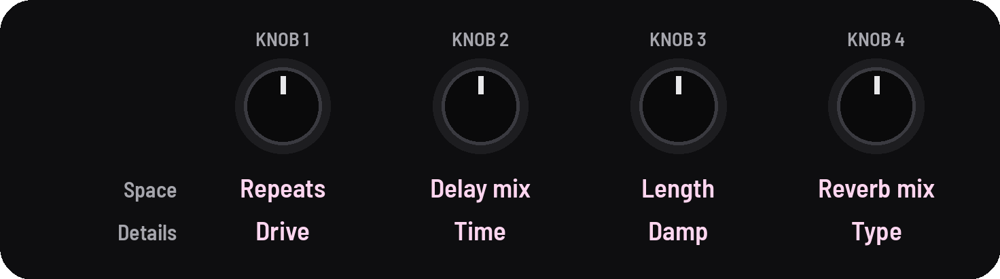

<!-- SPDX-License-Identifier: GPL-3.0-only -->

## Space and Details

The effects: a delay with six types, a drive, and a reverb with five.

## Knobs

[[FX]] opens Space, the amounts you play; [[FX]] again, Details, what you set before playing.

| Page | KNOB 1 | KNOB 2 | KNOB 3 | KNOB 4 |
|---|---|---|---|---|
| Space | delay repeats | delay mix | reverb length | reverb mix |
| Details | delay drive · SEL: — | delay time · SEL: delay type | reverb damp | reverb type · SEL: into reverb |

## Delay

| Knob | What it does |
|---|---|
| **Repeats** | how many echoes. Past about 85 they run away into self-oscillation |
| **Mix** | how loud the echoes are |
| **Time** | 70 ms to 1.46 s. Turning it bends the echoes' pitch, as tape does |
| **Type** | [[SEL]] + Time: one of six ([Delay types](#delay-types)) |
| **Drive** | distorts the drones and their echoes together: ghost notes, beating, crackle |

### Delay types

Plain to most alive.

| Type | What you hear |
|---|---|
| **Clean** | the echoes as played, no wow: a just-tuned drone stays still |
| **Wide** | the right side's echoes at three-quarters of the left's time |
| **Ping-pong** | the echoes bounce from side to side |
| **Tape** | warm, with a gentle wow; a new sound starts with it |
| **Grain** | Tape shaken by its own echoes |
| **Self** | Tape that sags as its echoes get louder |

## Reverb

| Knob | What it does |
|---|---|
| **Length** | 0.3 to 40 s. At the top, **Inf**: a freeze |
| **Mix** | how loud the reverb is |
| **Damp** | darkens the tail |
| **Type** | one of five ([Reverb types](#reverb-types)) |
| **Into reverb** | [[SEL]] + Type: Both, Echoes or Drones |

### Reverb types

Smallest to largest, then the two that move.

| Type | What you hear |
|---|---|
| **Room** | small and close |
| **Hall** | a hall: larger, a little further away |
| **Cathedral** | the largest and furthest, the tail starting latest |
| **Chorus hall** | a hall whose tail swings and shimmers, the widest |
| **Shimmer** | the Hall with an octave above what's playing, washing in over about 8 s |

## Good to know

### Delay

- **Drive** sits after the delay and before the reverb, and holds the loudness: the first fifth blends a little in,
  then up to a hard clip.
- **Runaway repeats** are held by a soft clip; [the header](controls.md#screen-header) says "runaway".

### Reverb

- **Into reverb:** Both (the drones and their echoes), Echoes (the drones stay dry), Drones (the echoes stay dry on
  top).
- **A freeze** holds what's in it (Damp is out at Inf); PLAY to stop lets it go.

### Both

- **Changing type** crossfades; the type knobs go round both ways.
- **The pictures:** on Space, the echoes as half-rings on the left and the reverb's tail as rings on the right; on
  Details, the same with the SEL choices above Time and Type.
- The delay and reverb are ChoralRoot's design (see [About](../about.md#where-it-came-from)).
