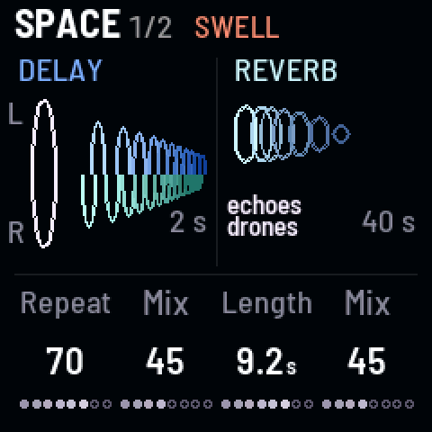
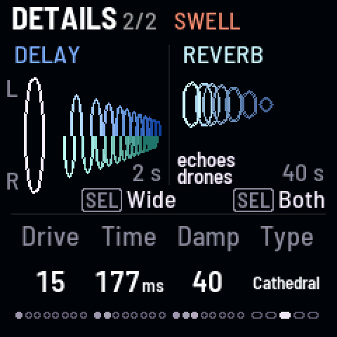

<!-- SPDX-License-Identifier: GPL-3.0-only -->

## The knobs

[[FX]] opens Space, the amounts you play; [[FX]] again, Details, what you set before playing.

| Page | KNOB 1 | KNOB 2 | KNOB 3 | KNOB 4 |
|---|---|---|---|---|
| Space | delay repeats | delay mix | reverb length | reverb mix |
| Details | delay drive · SEL: — | delay time · SEL: delay type | reverb damp | reverb type · SEL: into reverb |

## Delay

Echoes of the drones, before the reverb.

### Repeats

How many echoes. Past about 85 they run away into self-oscillation.

### Mix

How loud the echoes are.

### Time

70 ms to 1.46 s. Turning it bends the echoes' pitch, as tape does.

### Type

[[SEL]] + Time: Clean, Wide, Ping-pong, Tape, Grain or Self.

### Drive

Distorts the drones and their echoes together: ghost notes, beating, crackle.

## Reverb

A room around everything, last in the chain.

### Length

0.3 to 40 s. At the top, **Inf**: a freeze.

### Mix

How loud the reverb is.

### Damp

Darkens the tail.

### Type

Room, Hall, Cathedral, Chorus hall or Shimmer.

### Into reverb

[[SEL]] + Type: Both, Echoes or Drones.

## Good to know

- **Delay types**, plain to most alive: **Clean** (no wow, so a just-tuned drone stays still), **Wide** (the right
  side at three-quarters of the left's time), **Ping-pong**, **Tape** (warm, a gentle wow; a new sound starts with
  it), **Grain** (Tape shaken by its own echoes), **Self** (Tape that sags as its echoes get louder).
- **Reverb types:** Cathedral is the largest; Chorus hall shimmers; **Shimmer** adds an octave above what's playing,
  washing in over about 8 s.
- **Into reverb:** Both (the drones and their echoes), Echoes (the drones stay dry), Drones (the echoes stay dry on
  top).
- **Drive** sits after the delay and before the reverb, and holds the loudness: the first fifth blends a little in,
  then up to a hard clip.
- **Runaway repeats** are held by a soft clip; the header says "runaway".
- **A freeze** holds what's in it (Damp is out at Inf); PLAY to stop lets it go.
- **Changing type** crossfades; the type knobs go round both ways.
- **The pictures:** on Space, the echoes as half-rings on the left and the reverb's tail as rings on the right; on
  Details, the same with the SEL choices above Time and Type.
- The delay and reverb are ChoralRoot's design (see [About](../about.md#where-it-came-from)).
