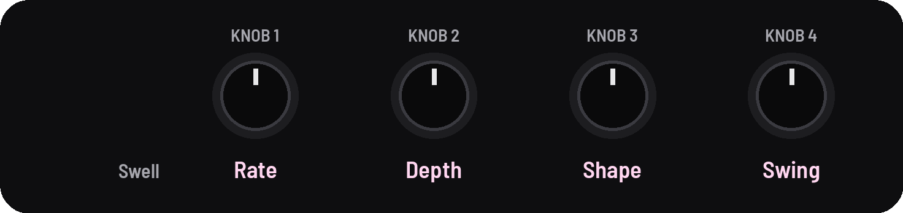
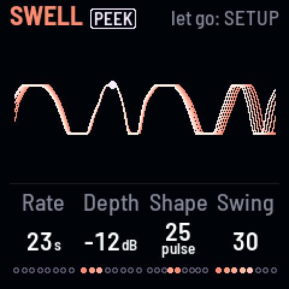

<!-- SPDX-License-Identifier: GPL-3.0-only -->

## Swell

A tremolo on both drones, from a slow breath to a hard gate, on its own or in time with a clock.

## Knobs

[[ARP]] opens the Swell page.

| Page | KNOB 1 | KNOB 2 | KNOB 3 | KNOB 4 |
|---|---|---|---|---|
| Swell | Rate (on a MIDI clock: division) | Depth | Shape | Swing |

## Controls

On the page, tap [[ARP]] to start or stop it.

| Knob | What it does |
|---|---|
| **Rate** | How fast it breathes. On a MIDI clock it's **Division**: 32 bars to a quarter note |
| **Depth** | How far it dips, down to −30 dB; all the way, silence |
| **Shape** | **Even** (a smooth breath) in the middle; a **ramp** to the right; a **pulse**, then a hard **gate**, to the left |
| **Swing** | Every other breath longer, up to 3 to 1 |

## Good to know

- **The starting sound** has it on: a slow breath, 40 deep. [The header](controls.md#screen-header) says **on**, or **off · tap ARP**.
- **"ramp 100":** the rise takes 97% of each breath.
- **An LFO locked to the Swell** ([[D#4]], held) restarts on its bars, so it follows a clock too.
- **The picture:** two bars, four breaths, as strands meeting at a dot where the Swell is now.
